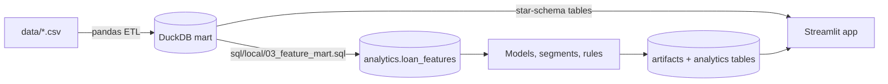

# Banking Analytics Data Warehouse

A single project for the two end-semester submissions: a Kimball-style banking
data warehouse and a loan-default analytics layer built on top of it. Raw PKDD'99
records are transformed into a star schema, turned into a leakage-safe feature
mart, and exposed through a Streamlit review app.


## Quick start

```powershell
python -m venv venv
venv\Scripts\activate
pip install -r requirements.txt

copy .env.example .env
python scripts\build_local.py
venv\Scripts\streamlit run app\streamlit_app.py
```

`build_local.py` runs the whole chain in one command: raw CSV extract, dimensions
and facts, DuckDB load, SQL feature mart, MLP/CBA training, cluster discovery,
saved analytics outputs, and validation counts. The app opens at
`http://localhost:8501`.

## Local architecture

Local runs use DuckDB, a single-file analytical database. Docker/Postgres is
optional; on this machine WSL2 virtualization is unavailable, so DuckDB is the
default backend. The table names and SQL stay close to the planned Snowflake
warehouse, and `sql/snowflake/` already holds the cloud DDL.



- Warehouse file: `data/banking_dw.duckdb`
- Schemas: `mart` (star schema) and `analytics` (features, scores, segments, rules)
- CSV snapshots: `data/clean/`
- Saved model and analysis outputs: `artifacts/`

## Data model

The star schema follows Kimball bottom-up design. Two fact tables share conformed
dimensions.

| Table | Grain | Rows |
|---|---|---:|
| `dim_date` | one day | 2,191 |
| `dim_branch` | one district/branch | 77 |
| `dim_customer` | one client | 5,369 |
| `dim_account` | one account | 4,500 |
| `dim_loan_type` | one loan product | 1 |
| `fact_loans` | one loan | 682 |
| `fact_transactions` | one transaction | 1,056,320 |

PKDD'99 has no loan product or interest rate, so `dim_loan_type` has one explicit
unknown member and `fact_loans.interest_rate` stays null rather than inventing a
rate. Duplicate account holders are kept as separate client rows; loan rows use
the account owner with the largest disbursement share.

## Analytics

- Six core classifiers compared under repeated cross-validation, with and without
  SMOTE: decision tree, Naive Bayes, random forest, SVM, KNN, and gradient
  boosting.
- Tuned gradient boosting is the current review model: F1 0.571, average
  precision 0.654, ROC AUC 0.864 on out-of-fold scores.
- Two additional models: an MLP reaches F1 0.439 / AUC 0.750, and a
  classification-rule learner (CBA) reaches precision 1.00 with recall 0.355
  (F1 0.524). The CBA rules all key off a negative minimum balance.
- KMeans (k=2) behaviour segments, plus k-medoids, AGNES (Ward), and DBSCAN
  compared side by side. The highest-risk group is DBSCAN noise at a 21.5%
  default rate, against an 11.1% base rate.
- FP-Growth and Apriori over pre-loan behaviour baskets. The strongest rule,
  `negative_balance -> default`, covers 27 loans with confidence 1.00 and lift
  8.97 against the 11.1% base rate.
- Every behavioural feature uses only transactions strictly before the loan date.
  `python scripts\build_local.py` prints `features with post-loan rows: 0`.

## Streamlit app

| Page | What it shows |
|---|---|
| Executive overview | Cutoff slider, stacked score distribution by observed outcome, gains curve, precision/recall trade-off across 5–90%, default rate by balance quintile, segment scatter, exposure |
| Data & leakage | Galaxy-table row-count dot plot, per-loan used/excluded transaction bars, feature provenance, quality checks |
| Models | Metric-aware repeated-CV mean ±1 SD dot plot, leaderboard, held-out heatmap, ROC/PR curves, confusion matrix, tuning chart, challenger dumbbell |
| Patterns | Frequent itemsets, default rules, CBA coverage bars with default counts, itemset support bars, cluster scatter with base-rate line, PCA maps |
| Simulator | What-if scoring with the saved gradient-boosting pipeline, portfolio score distribution, one-at-a-time drivers |
| Data model card | Galaxy schema diagram, analytics row-count chart, relationships, column dictionary |

Charts are chosen by the question: a histogram for the score distribution, lines for gains,
ROC, PR, and cutoff trade-offs, dot plots for repeated-CV means with uncertainty and for
table row counts, heatmaps for matrices, scatter or bubble charts for relationships,
stacked bars for outcome composition, a dumbbell for the paired challenger comparison,
and Graphviz for the schema. Every chart is Altair and reacts to the page controls —
cutoff, rank metric, resampling arm, variant, support threshold, segment, and simulator
inputs — with hover, zoom, and pan in the browser. Data comes from DuckDB tables and saved
artifacts, with CSV snapshots as a fallback. The schema diagram is rendered with Graphviz.

## Repository layout

```text
app/            Streamlit app and DuckDB access
artifacts/      Saved models, metrics, segments, rules, figures
data/           Raw CSVs, DuckDB file, clean snapshots
docs/           jury1/, jury2/, references/
notebooks/      Preprocessing, features, EDA, modelling, segmentation, clustering comparison
reports/        jury1/, jury2/, templates/
screenshots/    App captures
scripts/        ETL, local build, analytics load, Snowflake upload
sql/            local/, snowflake/, archive/
tests/          ETL and local-database checks
tools/          Capacity model and pattern mining
powerbi/        Jury 1 Power BI report
```

## Tests

```powershell
venv\Scripts\python.exe -m pytest tests -q
```

The suite checks ETL transforms, mart counts, loan/default counts, the absence of
post-loan rows in the feature mart, gender mapping, and analytics table sizes,
including the MLP, CBA, and cluster outputs.

## Snowflake

The local DuckDB build is the default. To push the same data to Snowflake:

1. Run `sql/snowflake/ddl_snowflake.sql` in Snowsight as `ACCOUNTADMIN`.
2. Copy `.env.example` to `.env` and fill in the `SNOWFLAKE_*` values. Either set `SNOWFLAKE_PASSWORD`
   (the loader prompts for a 6-digit TOTP if MFA is enabled) or create a programmatic access token:
   ```sql
   ALTER USER DHANUSHPILLAY ADD PROGRAMMATIC ACCESS TOKEN banking_dw_loader
     ROLE_RESTRICTION = 'ACCOUNTADMIN'
     DAYS_TO_EXPIRY = 1;
   ```
   Copy the returned `token_secret` into `SNOWFLAKE_PAT`. The loader uses the token first and skips
   MFA.
3. Install the connector: `venv\Scripts\python.exe -m pip install "snowflake-connector-python[pandas]"`.
4. Run `venv\Scripts\python.exe scripts\upload_to_snowflake.py`. With `SNOWFLAKE_PAT` set, no prompt
   appears; otherwise enter the TOTP code when asked.
5. Run `sql/snowflake/verify_load.sql` in Snowsight to compare row counts and preview the views.

The target is warehouse `PBI_WH`, database `LOAN_DEFAULT_DW`, schemas
`RAW` and `MART`. The loader writes to `RAW`.

### Hybrid Streamlit mode

The dashboard can read Snowflake for the main analytics tables while keeping
model metrics, pattern outputs, and the Data model card local:

```env
DATA_SOURCE=snowflake
SNOWFLAKE_PAT=<read-only-token>
```

The four Snowflake-backed tables are `RAW.MART_LOAN_FEATURES`,
`RAW.MART_MODEL_SCORES`, `RAW.MART_LOAN_SEGMENTS`, and
`RAW.MART_LOAN_RISK`. Everything else falls back to `artifacts/` CSVs, and the
Data model card stays on DuckDB because the star-schema dimensions and facts
are not uploaded.

For a read-only dashboard token, run this once as `ACCOUNTADMIN`:

```sql
CREATE ROLE IF NOT EXISTS DASHBOARD_READER;
GRANT USAGE ON WAREHOUSE PBI_WH TO ROLE DASHBOARD_READER;
GRANT USAGE ON DATABASE LOAN_DEFAULT_DW TO ROLE DASHBOARD_READER;
GRANT USAGE ON SCHEMA LOAN_DEFAULT_DW.RAW TO ROLE DASHBOARD_READER;
GRANT SELECT ON TABLE LOAN_DEFAULT_DW.RAW.MART_LOAN_FEATURES TO ROLE DASHBOARD_READER;
GRANT SELECT ON TABLE LOAN_DEFAULT_DW.RAW.MART_MODEL_SCORES TO ROLE DASHBOARD_READER;
GRANT SELECT ON TABLE LOAN_DEFAULT_DW.RAW.MART_LOAN_SEGMENTS TO ROLE DASHBOARD_READER;
GRANT SELECT ON TABLE LOAN_DEFAULT_DW.RAW.MART_LOAN_RISK TO ROLE DASHBOARD_READER;
GRANT SELECT ON TABLE LOAN_DEFAULT_DW.RAW.RAW_TRANS TO ROLE DASHBOARD_READER;
GRANT ROLE DASHBOARD_READER TO USER DHANUSHPILLAY;

ALTER USER DHANUSHPILLAY ADD PROGRAMMATIC ACCESS TOKEN streamlit_dashboard
  ROLE_RESTRICTION = 'DASHBOARD_READER'
  DAYS_TO_EXPIRY = 7;
```

Set `DATA_SOURCE=duckdb` (the default) to use the local warehouse only. Restart
Streamlit after changing `DATA_SOURCE` or `SNOWFLAKE_PAT`; cached connections and
reads are held by the running process. The older `SNOWFLAKE_SETUP_GUIDE.md` and
`sql/snowflake/snowflake_setup.sql` use different database names and do not match
the current loader.

## Dataset

[PKDD'99 Financial Dataset](https://www.kaggle.com/datasets/siavashraz/1999-czech-financial-dataset):
anonymized Czech banking records from 1993-1998. Raw CSVs live in `data/` and are
not generated by the build.
