# Customer Behavioral Analysis and Loan Default Classification

**Final report**  
PKDD'99 Czech banking data · local DuckDB warehouse · Streamlit review dashboard

---

## Abstract

This project predicts whether a loan will default using only information that was available before the loan was granted. The data comes from the PKDD'99 Czech banking dataset: 682 loans, 76 defaults, and 1,056,320 transactions between 1993 and 1998.

The work covers the full path from raw CSV extracts to a leakage-safe feature mart, six classifiers under repeated cross-validation, association-rule mining, customer segmentation, and a six-page interactive dashboard. The selected model is a tuned Gradient Boosting classifier with repeated-CV F1 `0.571 ± 0.120`, average precision `0.654`, and ROC-AUC `0.864`. Random Forest is statistically tied on F1 and leads on average precision and ROC-AUC, so the result is best read as a leading pair rather than a single winning algorithm.

The strongest signal is the customer's balance before the loan. Age and gender carry almost no predictive value. A simple balance screen below CZK 20,000 flags 97 of 682 applications and catches 34 of 76 defaults, with 35.1% precision against an 11.1% base rate.

---

## 1. Problem statement

A bank wants to prioritise manual review of loan applications. The target is binary:

| Label | Meaning |
|---|---|
| `0` — good | Loan completed, or running without payment problems |
| `1` — default | Loan completed unpaid, or running in debt |

The model must not use any transaction, balance, or account event that happened on or after the loan date. This is the central leakage rule of the project.

---

## 2. Dataset

| Table | Rows | Grain |
|---|---:|---|
| `loan.csv` | 682 | One loan |
| `trans.csv` | 1,056,320 | One account transaction |
| `client.csv` | 5,369 | One client |
| `account.csv` | 4,500 | One account |
| `disp.csv` | 5,369 | One client-account disposition |

The loan file contains 606 good loans and 76 defaults, an 11.14% default rate. Transaction types are `PRIJEM` (credit, 405,083), `VYDAJ` (debit, 634,571), and `VYBER` (cash withdrawal, 16,666).

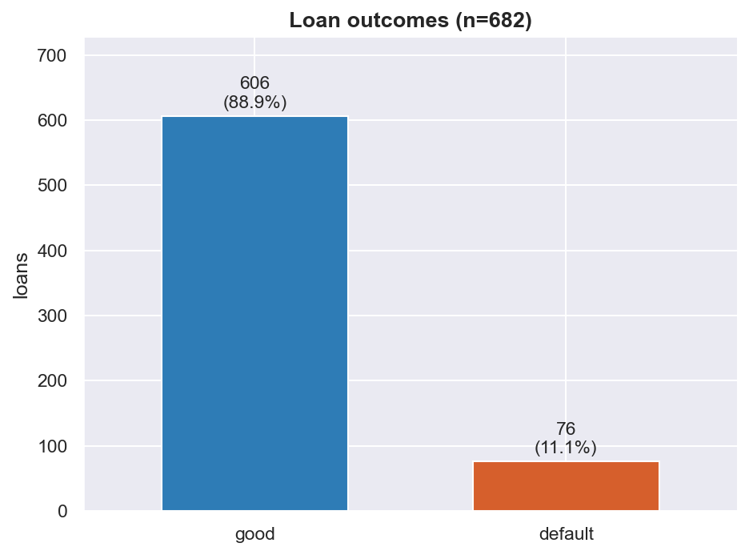

---

## 3. System architecture

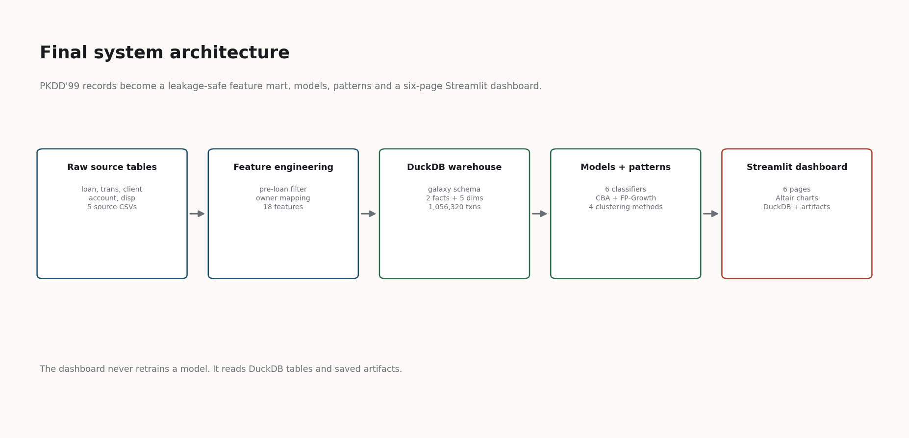

The local path is:

```text
raw CSVs
  -> DuckDB staging and galaxy schema
  -> leakage-safe feature mart
  -> model, pattern, and segment artifacts
  -> Streamlit dashboard
```

The Snowflake path is optional. The loader uploads the raw tables and four analytics tables. The dashboard can run in local DuckDB mode or hybrid Snowflake mode; the model and pattern CSVs stay local in both cases.

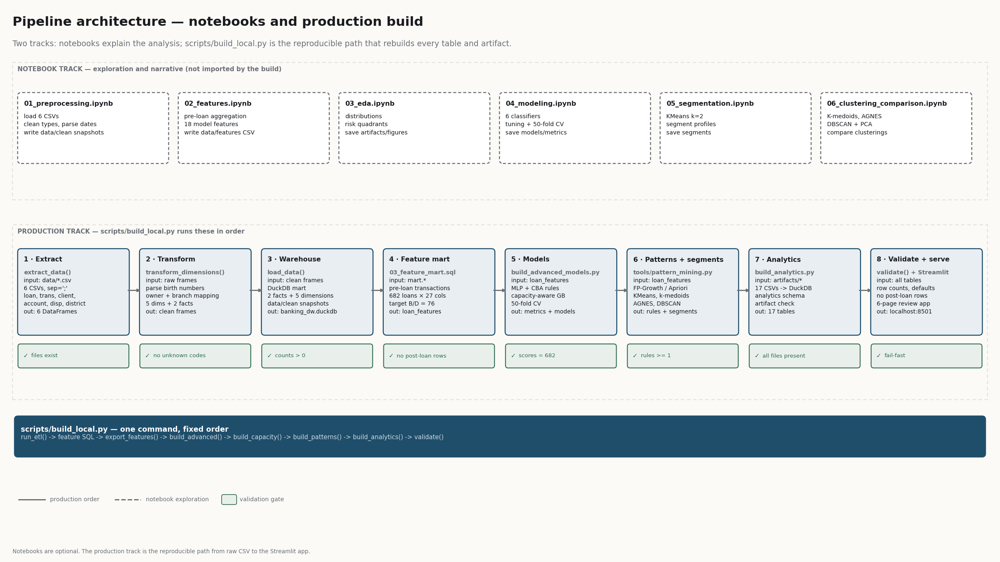

---

## 4. Data warehouse: galaxy schema

The warehouse has two fact tables and five conformed dimensions:

- `fact_loans`: one row per loan, 682 rows.
- `fact_transactions`: one row per transaction, 1,056,320 rows.
- `dim_date`: one row per day, 2,191 rows.
- `dim_branch`: one row per district/branch, 77 rows.
- `dim_customer`: one row per client, 5,369 rows.
- `dim_account`: one row per account, 4,500 rows.
- `dim_loan_type`: one unknown member, because the source has no loan product or interest-rate column.

One fact table with its dimensions is a star. Two fact tables sharing conformed account, branch, and date keys make a galaxy.

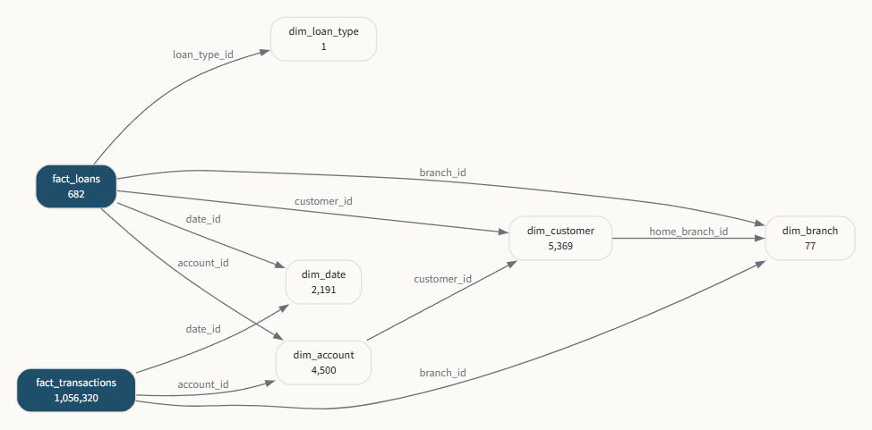

The dashboard reads this schema from DuckDB for the Data model card. The main analytics tables live in the `analytics` schema.

---

## 5. Feature engineering and leakage control

Each loan is converted into one row. For every loan, only transactions with a date strictly earlier than the loan date are included. The result is saved at `data/features/loan_features.csv` with 682 rows and 27 columns.

The 18 modelling features are:

- 13 behavioural features: transaction counts, turnover, average and minimum balance, balance at loan, transaction frequency, and related ratios.
- Loan terms: amount, duration, and payments.
- Limited demographics: age and gender.

All preprocessing, scaling, and SMOTE happen inside the scikit-learn pipeline. The scaler is fitted on the training fold only, so the validation and test folds are not contaminated.

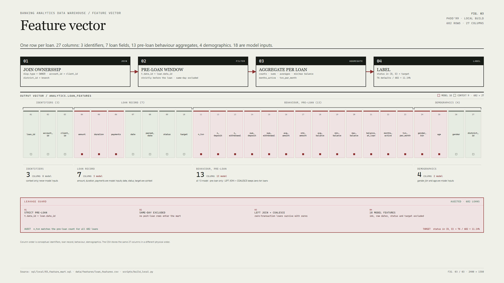

The build prints `features with post-loan rows: 0`. The test suite checks the same condition.

---

## 6. Exploratory findings

The target is imbalanced: 606 good loans and 76 defaults.


The strongest correlations with default are:

| Feature | Correlation |
|---|---:|
| `min_balance` | -0.26 |
| `balance_at_loan` | -0.20 |
| `avg_balance` | -0.16 |
| `payments` | +0.18 |
| `amount` | +0.17 |

Median balance at the loan date is CZK 39,500 for good loans and CZK 22,000 for defaults. Average balance is CZK 44,100 versus CZK 37,000. Transactions per month are almost identical: 5.7 versus 5.6.

The risk quadrant at the median balance and median loan amount gives a clearer picture:

| Balance | Loan amount | Default rate |
|---|---|---:|
| High | Low | 4.9% |
| High | High | 6.7% |
| Low | Low | 10.1% |
| Low | High | 23.3% |

A low balance combined with a large loan is the highest-risk combination.

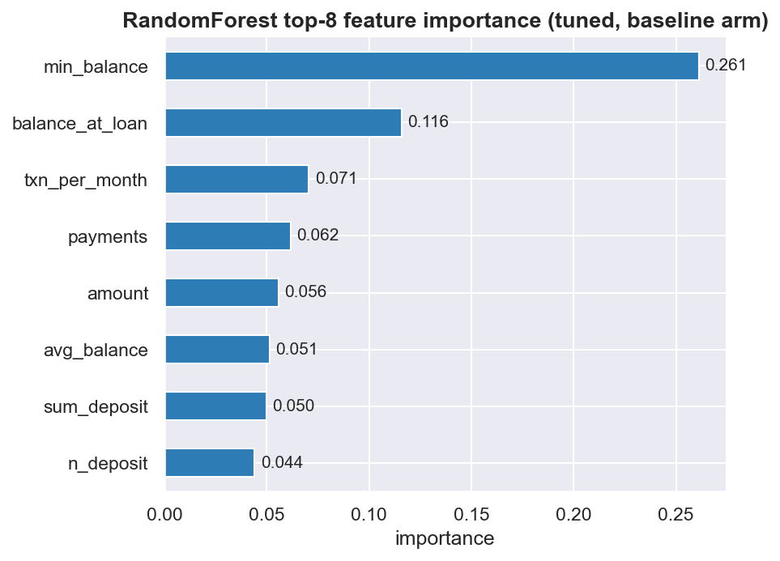

Random Forest importance agrees with the correlations: `min_balance` is the leading feature, followed by `balance_at_loan`, transaction frequency, payments, and amount. Age and gender are close to zero.

---

## 7. Models

Six classifiers were compared:

- Decision Tree
- Gaussian Naive Bayes
- Random Forest (200 trees)
- Calibrated SVM
- KNN (`k=5`)
- Gradient Boosting

Each was run with and without SMOTE, and with default or tuned hyperparameters: 24 configurations in total. Evaluation uses:

1. A stratified 75/25 train-test split as a held-out reference.
2. RandomizedSearchCV with inner 5-fold validation on the training split only.
3. RepeatedStratifiedKFold with 5 folds and 10 repeats: 50 estimates per configuration.

The selection rule is the highest repeated-CV F1 on the unresampled baseline arm.

### Repeated-CV results

| Model | Variant | F1 | Average precision | ROC-AUC |
|---|---|---:|---:|---:|
| Gradient Boosting | baseline, tuned | **0.571 ± 0.120** | 0.654 | 0.864 |
| Decision Tree | baseline, tuned | 0.557 ± 0.126 | 0.507 | 0.748 |
| Random Forest | baseline, tuned | 0.556 ± 0.112 | **0.661** | **0.877** |
| Random Forest | SMOTE, tuned | 0.542 | 0.638 | 0.872 |
| Gradient Boosting | SMOTE, tuned | 0.536 | 0.641 | 0.851 |
| SVM | baseline, tuned | 0.498 | 0.603 | 0.842 |
| KNN | baseline | 0.223 | 0.249 | 0.628 |

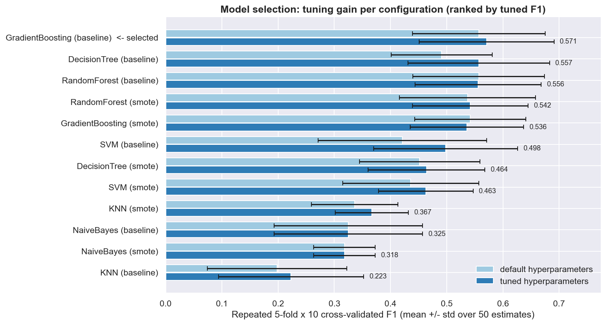

The top three F1 scores sit inside one standard deviation of each other. Random Forest has the best average precision and ROC-AUC. Gradient Boosting is selected because it has the highest F1 under the stated rule, not because it dominates every metric.

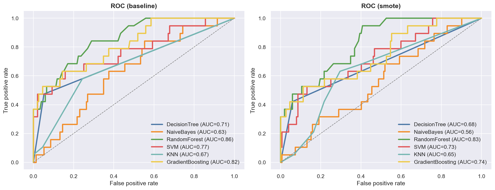

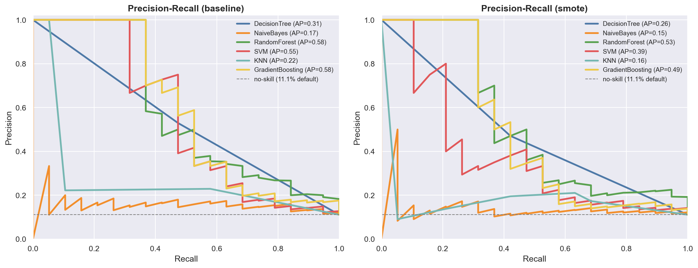

Average precision is the more informative ranking metric here because defaults are rare. The PR curves separate the models less cleanly than the ROC curves, which is expected at an 11% base rate.

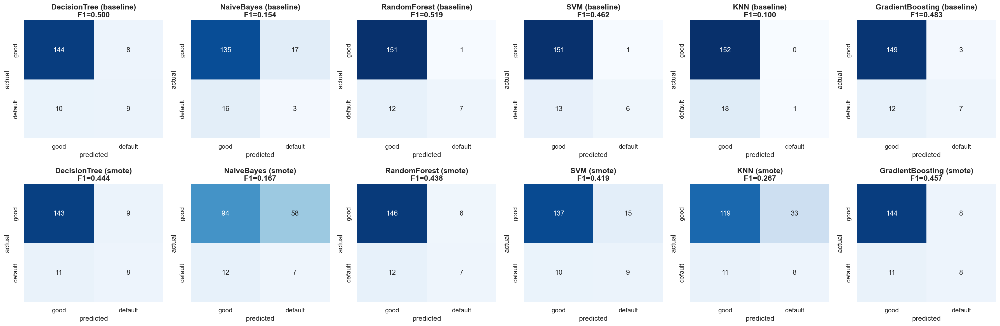

### Additional models

The advanced-model layer adds:

| Model | Precision | Recall | F1 | Average precision | ROC-AUC |
|---|---:|---:|---:|---:|---:|
| MLP | — | — | 0.439 | 0.446 | 0.750 |
| CBA rules | **1.000** | 0.355 | 0.524 | — | — |

The CBA rule classifier is precise but catches only about one third of defaults. Its rules are keyed to a negative minimum balance, which matches the feature-importance result.

### What the comparison says

- SMOTE lowers F1 for five of the six models. It helps KNN, but KNN remains the weakest model.
- Hyperparameter tuning materially helps SVM (`+0.077` F1) and Decision Tree (`+0.066` F1).
- The ensemble models are relatively stable under tuning.
- With only 76 defaults, differences below roughly 0.05 F1 are inside the observed fold-to-fold spread.

---

## 8. Pattern mining and segments

### Association rules

`tools/pattern_mining.py` treats each account's pre-loan activity as a basket. Items are transaction types, high-amount activity, and negative-balance behaviour. Apriori and FP-Growth both run with minimum support `0.03` and maximum itemset length `3`; both return the same 41 itemsets.

Two default-oriented rules survive:

| Rule | Support | Confidence | Lift |
|---|---:|---:|---:|
| `negative_balance -> default` | 0.0396 (27/682) | 1.000 | 8.97 |
| `type_VYBER -> default` | 0.0704 (48/682) | 0.130 | 1.17 |

The negative-balance rule covers all 27 loans with a negative minimum balance and 35.5% of all defaults. The cash-withdrawal rule is only slightly above the 11.1% base rate, so it is not a useful standalone screen.

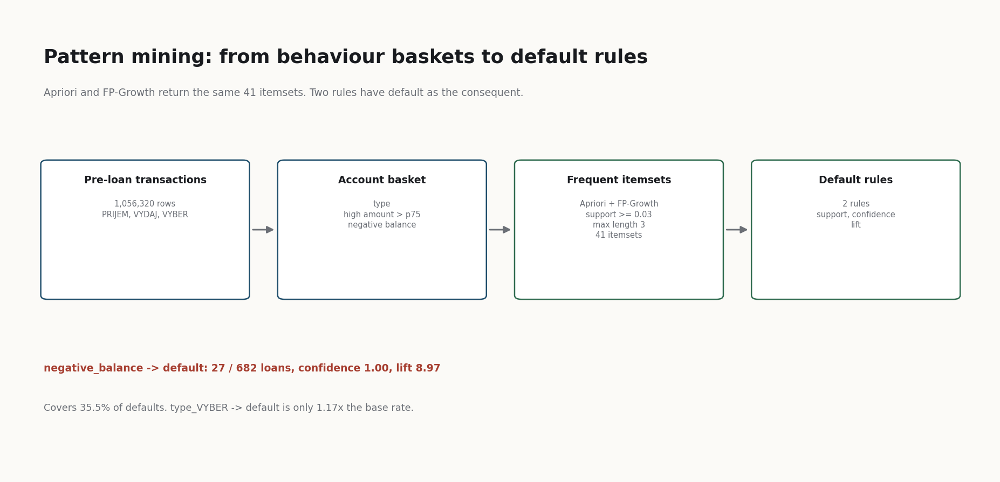

### Behaviour segments

KMeans with `k=2` gives a modest silhouette of 0.29:

| Segment | Loans | Default rate |
|---|---:|---:|
| Segment 0: quieter, thinner balances | 421 | 12.4% |
| Segment 1: more active, higher balances | 261 | 9.2% |

The segments overlap. They describe broad tendencies, not sharply separated customer types.

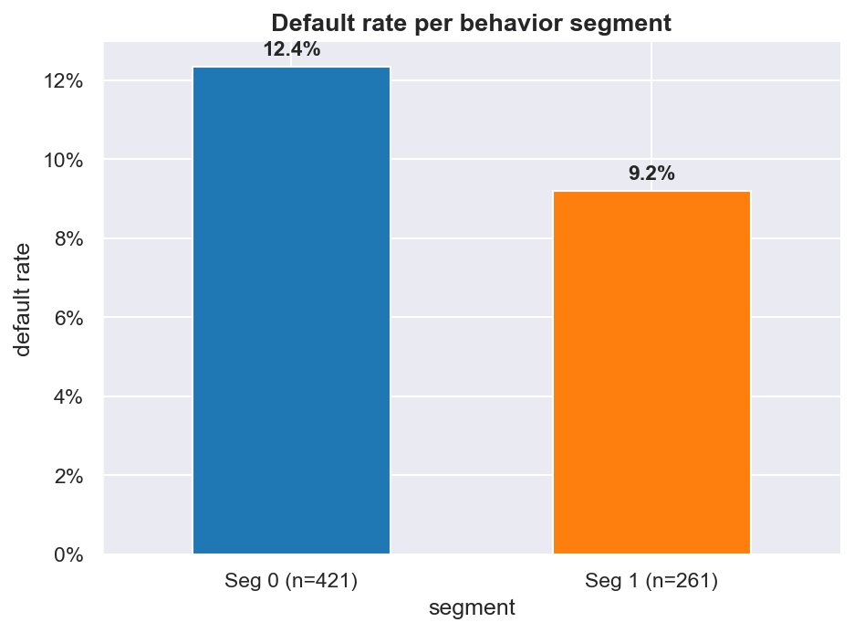

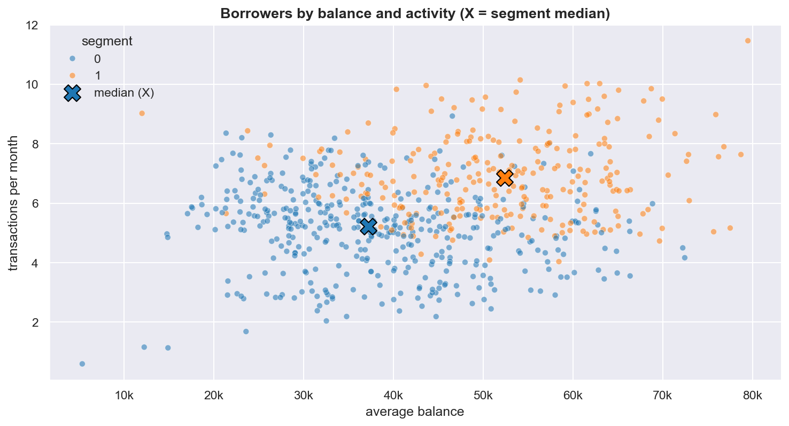

The clustering comparison also covers K-medoids, AGNES with Ward linkage, and DBSCAN. DBSCAN flags 21.5% of defaults as noise, against an 11.1% base rate; that is a warning that the cluster structure is not clean.

---

## 9. Interactive dashboard

The dashboard is a six-page Streamlit app. It reads the local DuckDB warehouse and saved artifacts; it does not retrain models on page load. All charts are Altair with hover, zoom, and pan. The schema view is Graphviz.

### Executive overview

Cutoff slider, stacked score histogram by observed outcome, cumulative gains curve, confusion matrix, exposure, precision/recall trade-off from 5% to 90%, quintile default rates with the base rate, and a segment scatter.

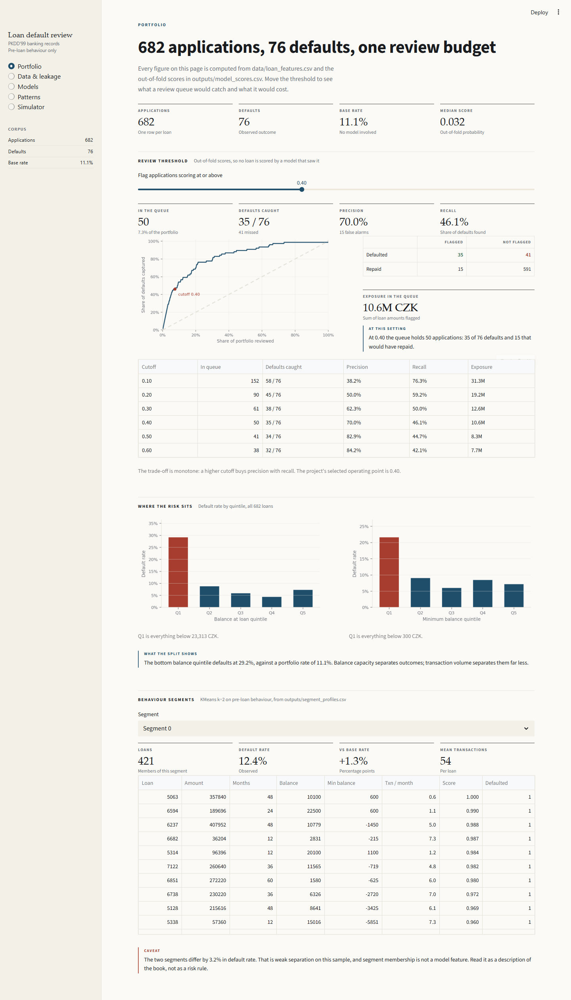

### Data and leakage

Galaxy-schema row-count dot plot, per-loan used/excluded transaction bars, feature provenance, and quality checks.

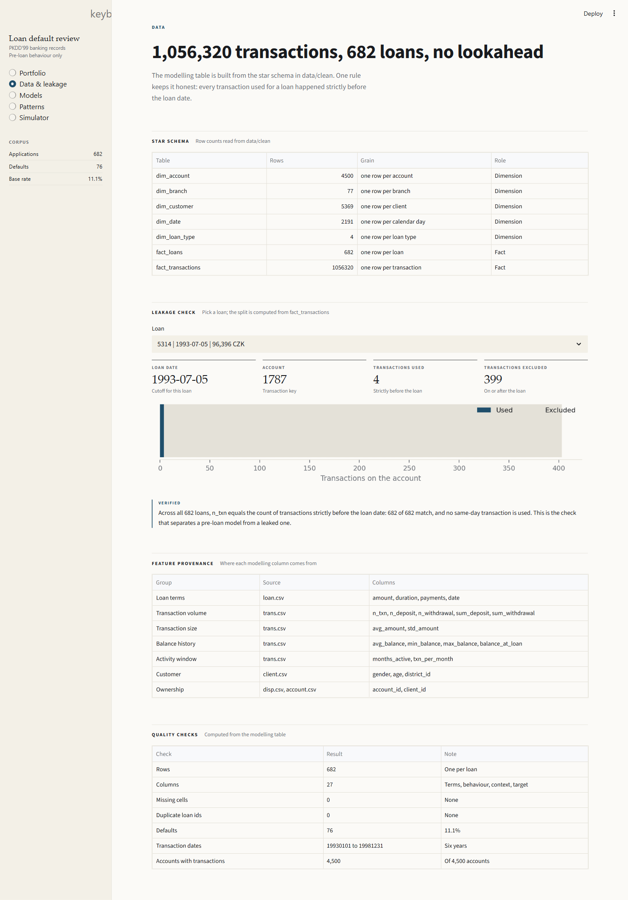

### Models

Metric-aware repeated-CV mean ±1 SD dot plot, ranking table, held-out metric heatmap, ROC and PR curves, confusion matrix, tuning results, and a challenger dumbbell chart.

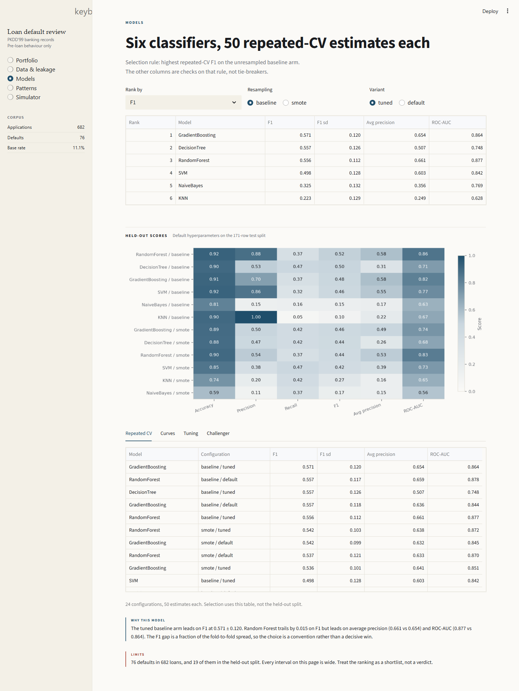

### Patterns

Default rules, CBA coverage bars with covered-default counts, itemset support bars, cluster scatter with a base-rate line, and PCA cluster maps.

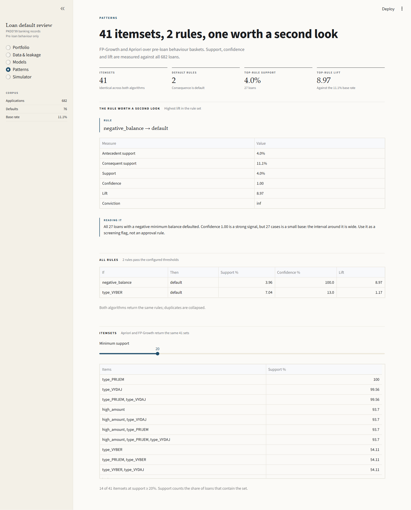

### Simulator

Scores one application with the saved tuned Gradient Boosting pipeline, shows it against the portfolio score distribution, and reports one-at-a-time stress drivers.

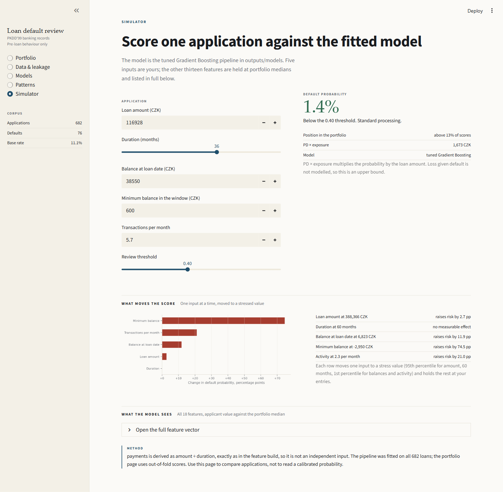

### Data model card

Graphviz galaxy diagram, analytics row-count chart, join keys, and column dictionary.

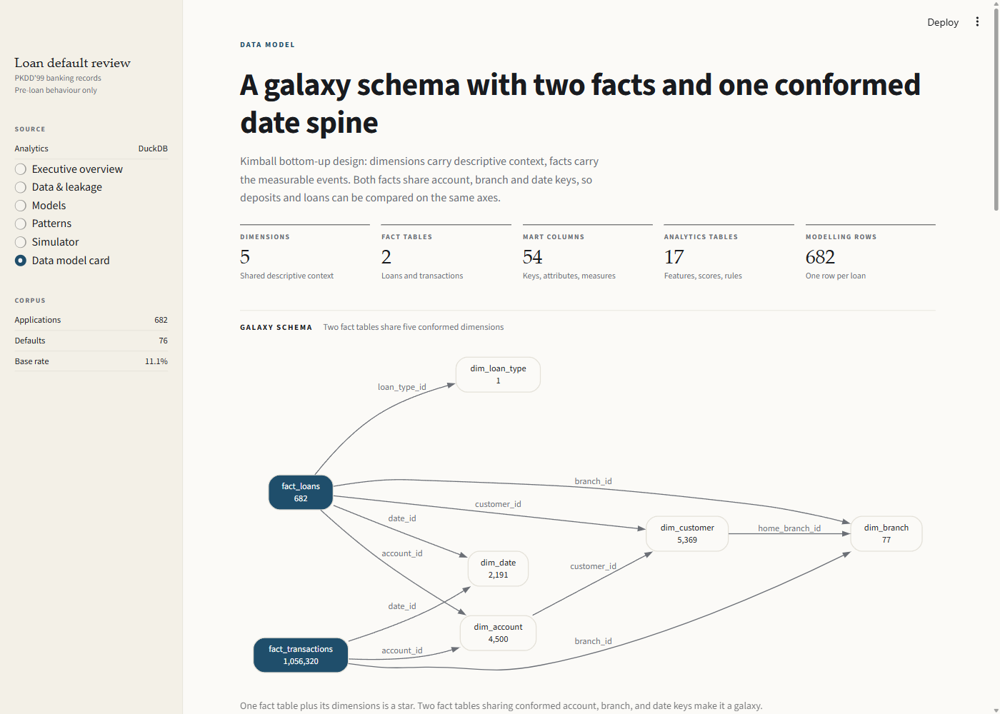

---

## 10. Recommendations

1. **Use the model as a review queue, not an automatic rejector.** At the selected cutoff, the queue is small enough for manual review.
2. **Add a balance screen.** A minimum balance below CZK 20,000 catches 34 of 76 defaults with 35.1% precision.
3. **Weight loan amount against balance capacity.** The low-balance/high-amount quadrant has a 23.3% default rate.
4. **Do not use age or gender as risk factors.** Their predictive value is close to zero, and using them would create fair-lending risk.
5. **Do not default to SMOTE.** It lowered F1 for five of six models.
6. **Retrain on recent data before production.** The dataset ends in 1998; the model is a historical demonstration, not a current credit policy.

---

## 11. Reproducibility

```powershell
python -m venv venv
venv\Scripts\activate
pip install -r requirements.txt
copy .env.example .env
python scripts\build_local.py
venv\Scripts\streamlit run app\streamlit_app.py
```

The dashboard opens at `http://localhost:8501`. The notebook pipeline (`notebooks/01` to `05`) remains reproducible with `nbconvert`. The local build also runs the advanced models, clustering, analytics tables, and validation checks.

The test suite is:

```powershell
venv\Scripts\python.exe -m pytest tests -q
```

---

## 12. Limitations

- Only 76 defaults are available, so the confidence intervals are wide.
- The held-out split contains 19 defaults; it is a reference check, not a precise estimate.
- The tuned CV score is slightly optimistic because the threshold is chosen from the same out-of-fold scores.
- The dataset is historical and small by modern credit-risk standards.
- Naive Bayes is included as a baseline, not as a production candidate.
- The CBA rule classifier has perfect precision but low recall; it should not replace the gradient-boosting score.

---

## Image index

| Image | Purpose |
|---|---|
| `01_system_architecture.png` | End-to-end system architecture |
| `02_pipeline_architecture.png` | Notebook and warehouse pipeline |
| `03_feature_vector.png` | Source tables to loan feature vector |
| `04_target_distribution.png` | Good/default class balance |
| `05_cv_selection.png` | Repeated-CV model comparison |
| `06_roc_curves.png` | ROC curves |
| `07_pr_curves.png` | Precision-recall curves |
| `08_confusion_matrices.png` | Confusion matrices |
| `09_feature_importance.png` | Random Forest feature importance |
| `10_segment_default_rates.png` | Default rate by segment |
| `11_segment_scatter.png` | Segment scatter |
| `12_pattern_mining_flow.png` | Pattern-mining process |
| `13_dashboard_executive.png` | Executive overview page |
| `14_dashboard_models.png` | Models page |
| `15_dashboard_patterns.png` | Patterns page |
| `16_dashboard_data_leakage.png` | Data and leakage page |
| `17_dashboard_simulator.png` | Simulator page |
| `18_galaxy_schema.png` | Galaxy schema diagram |
| `19_dashboard_data_model.png` | Data model card page |
