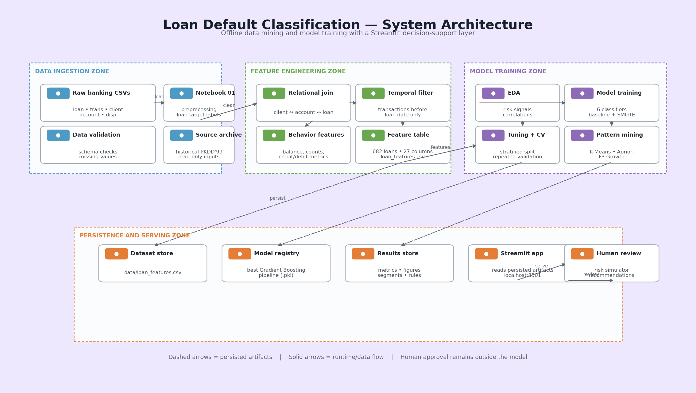

# Customer Behavioral Analysis and Loan Default Classification

> **Status note:** This is the earlier consolidated project report. The authoritative, current report is `Jury2_Report.md`. The dashboard, pattern-mining counts, artifact paths, and reproduction commands below have been updated to match the current DuckDB/Streamlit build.

## 1. Executive Summary

This project develops an end-to-end data mining and machine learning solution for identifying loan default risk from customer financial behavior. It uses the PKDD'99 Financial Dataset, which contains anonymized Czech bank records from 1993 to 1998.

The project combines transaction-level feature engineering, exploratory analysis, six classification algorithms, hyperparameter tuning, repeated cross-validation, customer segmentation, association-rule mining, and an interactive Streamlit dashboard. The primary business question is:

> Can pre-loan transaction behavior help a bank identify applications that are more likely to default before approving the loan?

The final dataset contains 682 loans: 606 good loans and 76 defaults. The selected headline model is tuned Gradient Boosting trained on the original imbalanced data. It achieves repeated cross-validated F1 of **0.571 +/- 0.120**, Average Precision of **0.654**, and ROC-AUC of **0.864**. Tuned Random Forest is a close alternative, with F1 of 0.556, Average Precision of 0.661, and ROC-AUC of 0.877.

The strongest risk signals are low pre-loan balances, especially `min_balance` and `balance_at_loan`. The results support a balance-capacity review as a useful screening aid, but not an automatic lending decision. The data is historical and contains only 76 defaults, so the model must be revalidated on current portfolio data before production use.

## Rubric Coverage Summary

### Brief Introduction

Loan default classification uses historical customer and account behavior to estimate whether a new loan application is likely to become problematic. In this project, the bank's pre-loan transaction history is converted into measurable behavioral indicators, analyzed for risk patterns, and used to train classification models. The objective is decision support: applications with elevated estimated risk can receive additional review before approval.

### Dataset (3 marks)

The project uses the PKDD'99 Financial Dataset, an anonymized Czech banking dataset covering 1993 to 1998. It contains customer, account, relationship, transaction, and loan tables. The most important scale figures are approximately 1.06 million transactions, 4,500 accounts, 5,369 clients, and 682 loans. The final modeling population contains 606 good loans and 76 defaults.

### Architecture Diagram (3 marks)

The project architecture flows from raw CSV files through preprocessing, feature engineering, EDA, model training, segmentation, and pattern mining. The outputs are persisted as CSV metrics, figures, segment profiles, pattern tables, and a tuned model pipeline. The Streamlit application reads these artifacts for interactive review. The Mermaid architecture diagram is provided in [Section 4](#4-end-to-end-architecture).

### Inputs and Outputs (3 marks)

**Inputs:** `loan.csv`, `trans.csv`, `client.csv`, `account.csv`, and `disp.csv`. The main predictive input is a loan-level row containing pre-loan behavioral features, loan terms, and limited demographic context.

**Outputs:** `data/features/loan_features.csv`, model metrics, cross-validation comparisons, tuning results, figures, the persisted best-model pipeline, segment profiles, FP-Growth/Apriori itemsets and rules, and the Streamlit dashboard views.

### Class Labels (3 marks)

The target is binary:

| Original status | Project label | Meaning |
|---|---|---|
| A, C | `good` / 0 | Loan completed or running without payment problems |
| B, D | `default` / 1 | Loan completed unpaid or running in debt |

The class distribution is 606 good loans (88.86 percent) and 76 defaults (11.14 percent). Because the default class is smaller, accuracy is never used alone to judge the models.

### Pattern Matching, FP-Growth, and Apriori (3 marks)

Pattern matching is included as a supplementary behavioral-analysis layer. Each account's transactions before its first loan are represented as a basket of recurring items such as transaction type, high-amount activity, and negative balance. Apriori enumerates frequent itemsets, while FP-Growth uses a compressed pattern tree and is more efficient for larger or denser basket collections.

Both methods use minimum support 0.05 and maximum itemset length three. The current run produces 25 Apriori itemsets and 25 FP-Growth itemsets. No default-consequent rule reaches the configured confidence threshold, so the result is reported transparently rather than inventing a risky rule. Pattern mining complements the classifier by producing interpretable co-occurrence evidence; it does not replace model-based prediction.

### Comparison with Other Classification Algorithms (5 marks)

The project compares Decision Tree, Gaussian Naive Bayes, Random Forest, calibrated SVM, KNN, and Gradient Boosting. Every algorithm is evaluated with the original imbalanced data and with a training-only SMOTE arm. The comparison uses the same feature table, split logic, tuning strategy, and repeated cross-validation protocol, making the results comparable.

Tuned Gradient Boosting is selected by F1. Random Forest is the closest leading alternative and is stronger on Average Precision and ROC-AUC. Decision Tree is interpretable but has weaker ranking metrics. SVM benefits most from tuning. Naive Bayes is a useful probabilistic baseline, while KNN is the weakest overall except for its improvement under SMOTE.

### Validation Test (5 marks)

The data is split with stratification into 75 percent training and 25 percent held-out testing. The test set contains 171 loans and 19 defaults. Default-setting test metrics, confusion matrices, ROC curves, and precision-recall curves are recorded in `artifacts/metrics/metrics_comparison.csv` and the figures directory.

The held-out test is treated as a reference check rather than the sole selection basis. Hyperparameters are searched on the training split using inner 5-fold stratified validation. Final selection uses `RepeatedStratifiedKFold` with 5 folds and 10 repeats, producing 50 estimates per configuration. This design exposes fold-to-fold uncertainty and reduces the chance of selecting a model because of one favorable split.

### Classification Algorithms (5 marks)

The six implemented classification algorithms are:

1. **Decision Tree:** interpretable nonlinear rules and feature splits.
2. **Gaussian Naive Bayes:** fast probabilistic baseline based on conditional feature distributions.
3. **Random Forest:** an ensemble of decision trees that provides robust nonlinear prediction and feature importance.
4. **Calibrated SVM:** a margin-based classifier with calibrated probabilities for ROC and precision-recall analysis.
5. **KNN:** a distance-based baseline that compares an application with nearby observations.
6. **Gradient Boosting:** sequentially fitted trees that correct previous errors and provide a strong tabular-data classifier.

All model transformations are placed inside pipelines. Standardization and SMOTE are learned only from each training fold, preventing data leakage.

### Innovation Added to the Classification Algorithm (5 marks)

The main innovation is the evaluation and feature-design strategy rather than claiming a new mathematical classifier. First, all behavioral features are restricted to transactions before the loan date, preventing post-decision leakage. Second, the project evaluates baseline and SMOTE pipelines consistently instead of assuming that class balancing improves every model. Third, randomized tuning is combined with 50 repeated-CV estimates, so model selection includes uncertainty rather than relying on one split. Fourth, the classifier is supported by balance-capacity risk analysis, customer segmentation, and association-rule mining. Finally, the selected pipeline is persisted and exposed through an interactive dashboard for reproducible review.

### Performance Metrics (5 marks)

The project reports Accuracy, Precision, Recall, F1-score, Average Precision, and ROC-AUC. Accuracy describes total correctness but can be misleading with only 11.14 percent defaults. Precision measures how many flagged applications are actually defaults. Recall measures how many defaults are caught. F1 balances precision and recall. Average Precision is especially useful under class imbalance because it evaluates the precision-recall ranking. ROC-AUC measures ranking separation across thresholds.

The selection result is tuned baseline Gradient Boosting with F1 **0.571 +/- 0.120**, Average Precision **0.654**, and ROC-AUC **0.864**. Tuned baseline Random Forest records F1 **0.556 +/- 0.112**, Average Precision **0.661**, and ROC-AUC **0.877**. The full comparison table appears in the classification section below.

## 2. Problem Statement and Objectives

Loan defaults create direct financial losses and increase the cost of credit operations. A bank needs an evidence-based way to identify applications that deserve additional review while avoiding unnecessary rejection of reliable customers.

This project treats default prediction as a binary classification problem. Loans with status codes A and C are mapped to `good`; loans with status codes B and D are mapped to `default`. The prediction uses information available before the loan grant date so that the analysis does not use post-loan leakage.

### Objectives

1. Clean and integrate the source banking tables.
2. Build behavioral features from pre-loan transactions.
3. Explore the relationship between behavior and default.
4. Compare six classification algorithms under baseline and SMOTE settings.
5. Select a model using repeated stratified cross-validation rather than one test split.
6. Identify broad customer behavior segments.
7. Discover recurring transaction patterns using Apriori and FP-Growth.
8. Provide an interactive dashboard for comparison, explanation, and pattern review.

## 3. Dataset and Sources

The source is the PKDD'99 Financial Dataset. The repository stores the raw tables in `data/`.

| Table | Role | Description |
|---|---|---|
| `loan.csv` | Target and loan terms | Loan amount, duration, payments, grant date, and status |
| `trans.csv` | Behavioral source | Account transactions, type, amount, balance, and date |
| `client.csv` | Customer attributes | Client identity, birth number, and district |
| `account.csv` | Account metadata | Account creation, district, and statement frequency |
| `disp.csv` | Relationship table | Links clients to accounts and identifies account owners |

The transaction table contains approximately 1.06 million records. The loan table contains 682 loans. The final target distribution is 606 good loans and 76 defaults, giving an 11.14 percent default rate.

## 4. End-to-End Architecture



The architecture is divided into data sources, the data and feature pipeline,
analytics and training, persisted artifacts, and serving/review. The offline
path produces reusable datasets, metrics, models, and pattern outputs. The
Streamlit application reads those artifacts for interactive review; it does
not retrain the model during dashboard use.

The notebooks are executed in order:

1. `01_preprocessing.ipynb` cleans the source tables and defines the target.
2. `02_features.ipynb` creates the loan-level modeling table.
3. `03_eda.ipynb` explores distributions, correlations, and risk groups.
4. `04_modeling.ipynb` trains, tunes, evaluates, and saves the best model.
5. `05_segmentation.ipynb` creates behavior-based customer segments.
6. `06_clustering_comparison.ipynb` compares K-medoids, AGNES and DBSCAN.

The current local build scripts live in `scripts/`; `tools/` holds the capacity-aware and pattern-mining experiments.

## 5. Data Preparation and Feature Engineering

Dates are parsed using the source format `%y%m%d`. The target is created from loan status. Owner relationships are used so each loan is connected to the correct client and account.

For every loan, only transactions strictly earlier than the loan grant date are selected. This prevents information from after the lending decision entering the predictors. The engineered table is saved as `data/features/loan_features.csv` with 682 rows and 27 columns.

### Behavioral features

The 13 primary behavioral features are:

- Transaction count, deposit count, and withdrawal count.
- Deposit and withdrawal totals.
- Average and standard deviation of transaction amount.
- Average, minimum, and maximum balance.
- Balance on the last transaction before the loan.
- Months of account history.
- Transactions per month.

Loan terms and demographic context are joined afterward. Gender is binary encoded. Continuous modeling features are standardized inside the training pipeline, which prevents scaling information from leaking across folds.

Data-quality checks found no duplicate rows in the source tables, no missing values in the final modeling table, valid dates, and plausible age values. Transaction amount and balance fields are skewed, and several volume variables are strongly correlated. These characteristics are documented and considered when interpreting feature importance.

## 6. Exploratory Data Analysis

The exploratory analysis is implemented in `03_eda.ipynb` and produces the figures in `artifacts/figures/`.

### Main findings

- The dataset is imbalanced: 11.14 percent of loans are defaults.
- `min_balance`, `balance_at_loan`, and `avg_balance` have the strongest negative relationships with default.
- The median balance at loan time is approximately 39.5k for good loans and 22.0k for defaults.
- Transaction frequency alone separates the classes weakly; balance capacity is more informative than activity volume.
- Loan amount and payments show a modest positive relationship with default.
- Age and gender show little useful predictive signal and should not be used as decision factors.
- The risk quadrant combining pre-loan balance and loan amount ranges from 4.9 percent default for high-balance, low-amount loans to 23.3 percent for low-balance, high-amount loans.

The analysis also identifies multicollinearity among transaction volume variables. For example, deposit and withdrawal totals are highly correlated. This is why the project interprets related features together rather than treating one importance score as a causal explanation.

## 7. Classification and Evaluation

### Innovation: Capacity-Aware Gradient Boosting

The project evaluates a new model version rather than claiming that ordinary
hyperparameter tuning is itself a new algorithm. The capacity-aware challenger
extends the tuned Gradient Boosting pipeline with four domain features:

- `loan_to_avg_balance`: loan amount relative to non-negative average balance.
- `loan_to_balance_at_loan`: loan amount relative to non-negative balance at the loan date.
- `payment_to_avg_balance`: monthly payment relative to non-negative average balance.
- `negative_min_balance`: indicator for a negative pre-loan minimum balance.

The ratio features are clipped and log-transformed to limit the effect of
near-zero balances. The model uses the same regularized Gradient Boosting
configuration as the headline model (`300` estimators, learning rate `0.05`,
maximum depth `1`, and subsample `0.7`). Because defaults are the Class 1
minority, the challenger selects its probability threshold from inner
five-fold validation rather than assuming that `0.50` is optimal.

The reproducible experiment is implemented in
`tools/capacity_aware_model.py`. It uses 5-fold x 3 repeated outer validation
for this nested threshold experiment; the original headline comparison keeps
the definitive 5-fold x 10 repeated validation. Results are saved in
`artifacts/metrics/capacity_model_comparison.csv`,
`artifacts/metrics/capacity_model_fold_results.csv`, and
`artifacts/models/capacity_aware_metadata.json`.

The measured result is intentionally reported as a challenger, not an
unqualified replacement:

| Model | F1 at default threshold | F1 with inner-CV threshold | Average Precision | ROC-AUC |
|---|---:|---:|---:|---:|
| Current tuned Gradient Boosting | 0.575 | 0.545 | 0.648 | 0.864 |
| Capacity-aware Gradient Boosting | 0.567 | 0.567 | 0.647 | **0.868** |

The capacity-aware version improves ranking separation slightly, but it does
not improve F1 on this small sample. Therefore the current Gradient Boosting
model remains the headline classifier, while the capacity-aware model provides
an interpretable ranking challenger for future validation on a larger,
more-current portfolio.

Six models are compared:

1. Decision Tree
2. Gaussian Naive Bayes
3. Random Forest
4. Calibrated Support Vector Machine
5. K-Nearest Neighbors
6. Gradient Boosting

Each model is evaluated in two settings: the original imbalanced training data and a training-only SMOTE pipeline. The model workflow includes a stratified 75/25 split, randomized hyperparameter search, and repeated stratified 5-fold cross-validation with 10 repeats. Each repeated-CV row therefore contains 50 estimates.

The held-out test metrics are retained as a readable reference, but model selection is based on repeated cross-validation because a single split contains only 19 defaults.

### Repeated-CV selection table

| Model and setting | Tuned F1 | Average Precision | ROC-AUC |
|---|---:|---:|---:|
| Gradient Boosting, baseline | **0.571 +/- 0.120** | 0.654 | 0.864 |
| Decision Tree, baseline | 0.557 +/- 0.126 | 0.507 | 0.748 |
| Random Forest, baseline | 0.556 +/- 0.112 | **0.661** | **0.877** |
| Random Forest, SMOTE | 0.542 +/- 0.103 | 0.638 | 0.872 |
| Gradient Boosting, SMOTE | 0.536 +/- 0.101 | 0.641 | 0.851 |
| SVM, baseline | 0.498 +/- 0.128 | 0.603 | 0.842 |
| Decision Tree, SMOTE | 0.464 +/- 0.104 | 0.307 | 0.741 |
| SVM, SMOTE | 0.463 +/- 0.084 | 0.608 | 0.848 |
| KNN, SMOTE | 0.367 +/- 0.065 | 0.367 | 0.768 |
| Naive Bayes, baseline | 0.325 +/- 0.132 | 0.356 | 0.769 |
| Naive Bayes, SMOTE | 0.318 +/- 0.055 | 0.338 | 0.729 |
| KNN, baseline | 0.223 +/- 0.129 | 0.249 | 0.628 |

### Model selection interpretation

Tuned Gradient Boosting is the headline model because it has the highest repeated-CV F1 under the stated selection rule. Random Forest belongs to the same leading group: its F1 is within the observed fold-to-fold variation and it leads on Average Precision and ROC-AUC. Therefore, Gradient Boosting is a defensible classification choice, while Random Forest may be preferred when the bank primarily wants a high-quality ranking of applications.

SMOTE improves KNN but reduces tuned F1 for the other five models. This indicates that resampling should not be adopted automatically. Hyperparameter tuning has its largest positive effect on SVM and Decision Tree, while the two ensemble models are relatively stable.

The persisted headline pipeline is stored at `artifacts/models/best_GradientBoosting_baseline_tuned.pkl`.

## 8. Feature and Risk Interpretation

Random Forest feature importance and correlation analysis identify low balances as the most consistent risk signal. The most important variables include:

- `min_balance`
- `balance_at_loan`
- `txn_per_month`
- `payments`
- `amount`
- `avg_balance`

These results do not establish that low balance causes default. They indicate that low demonstrated liquidity is useful for prioritizing review. Age and gender contribute little signal and should remain descriptive context rather than lending decision variables.

## 9. Customer Segmentation

The segmentation notebook applies KMeans to the 13 behavioral features without using the target during clustering. A two-segment solution is selected using the silhouette assessment.

| Segment | Behavioral profile | Size | Default rate |
|---|---|---:|---:|
| 0 | Quieter activity and lower average balance | 421 | 12.4% |
| 1 | More active accounts and higher average balance | 261 | 9.2% |

The segments overlap and the silhouette score is modest, so these groups describe broad tendencies rather than sharply separated customer types. The quieter, thinner-balance segment has the higher default rate and can guide review prioritization.

## 10. Pattern Recognition with Apriori and FP-Growth

The pattern-mining layer treats each account's pre-loan activity as a basket. Basket items include transaction types, high-amount activity, and negative-balance behavior. The implementation is in `tools/pattern_mining.py`.

Both methods run with a minimum support of 0.03 and maximum itemset length of three. The generated outputs are:

- `artifacts/rules/pattern_itemsets.csv`: 41 unique itemsets. The file has 82 rows because Apriori and FP-Growth each contribute a run.
- `artifacts/rules/pattern_rules.csv`: two default-oriented association rules.

The main rule is `negative_balance -> default`: support 0.0396 (27 of 682 loans), confidence 1.000, lift 8.97. Every loan with a negative minimum balance in the pre-loan window defaulted, and the rule covers 35.5% of the 76 defaults. The second rule, `type_VYBER -> default`, has support 0.0704 (48 of 682), confidence 0.130, lift 1.17, only slightly above the 11.1% base rate. The contrast is the useful result: a negative balance is a strong signal, while cash withdrawals alone are not.

Apriori is useful as an explainable baseline that enumerates candidate itemsets. FP-Growth is more efficient when the basket collection is larger or contains dense repeated combinations. Neither method replaces the predictive classifier; it provides an interpretable pattern-discovery layer alongside classification.

## 11. Streamlit Dashboard

The dashboard is implemented in `app/streamlit_app.py` using Streamlit. It reads the local DuckDB warehouse and saved artifacts rather than retraining models on every page load. It has six pages:

- **Executive overview:** cutoff slider, stacked score histogram by observed outcome, cumulative gains curve, precision/recall trade-off over cutoffs 5-90%, default rate by balance quintile with the base rate, and a loan-level segment scatter.
- **Data & leakage:** galaxy-schema row-count dot plot, per-loan used/excluded transaction bars, feature provenance, and data-quality checks.
- **Models:** metric-aware repeated-CV mean ±1 SD dot plot, ranking table, held-out metric heatmap, ROC and precision-recall curves, confusion matrix, tuning results, and a challenger dumbbell chart.
- **Patterns:** default rules, CBA coverage bars with covered-default counts, itemset support bars, cluster scatter with a base-rate line, and PCA cluster maps.
- **Simulator:** scores one application with the saved tuned Gradient Boosting pipeline, shows it against the portfolio score distribution, and reports one-at-a-time stress drivers.
- **Data model card:** Graphviz galaxy-schema diagram, analytics row-count chart, relationship list, and column dictionary.

All charts are Altair with hover, zoom, and filter controls; the schema diagram is Graphviz. The dashboard can be opened locally at `http://localhost:8501` after starting Streamlit.

## 12. Repository Structure and Deliverables

- `app/`: Streamlit dashboard, entry point `app/streamlit_app.py`.
- `artifacts/`: metrics, models, figures, rules, segments, and snapshots.
- `data/`: raw CSVs, cleaned tables, `features/loan_features.csv`, and `banking_dw.duckdb`.
- `docs/`: reports, requirements, references, and project documentation.
- `notebooks/`: executed analysis pipeline from preprocessing through clustering comparison.
- `scripts/`: local warehouse build, ETL, advanced models, analytics, and Snowflake upload.
- `sql/`: local feature-mart SQL and Snowflake setup.
- `tests/`: pytest checks for mart counts, leakage, and analytics tables.
- `tools/`: capacity-aware and pattern-mining experiments.
- `powerbi/`: Power BI deliverables.

Important generated deliverables include `data/features/loan_features.csv`, `artifacts/metrics/metrics_comparison.csv`, `artifacts/metrics/cv_comparison.csv`, `artifacts/metrics/tuning_results.csv`, `artifacts/segments/segment_profiles.csv`, `artifacts/rules/pattern_itemsets.csv`, `artifacts/rules/pattern_rules.csv`, the saved best-model pipeline, and the figures under `artifacts/figures/`.

## 13. Reproducibility

From the repository root, install the requirements and execute the notebooks in order:

```bash
pip install -r requirements.txt
python -m nbconvert --to notebook --execute notebooks/01_preprocessing.ipynb --output 01_preprocessing.ipynb
python -m nbconvert --to notebook --execute notebooks/02_features.ipynb --output 02_features.ipynb
python -m nbconvert --to notebook --execute notebooks/03_eda.ipynb --output 03_eda.ipynb
python -m nbconvert --to notebook --execute notebooks/04_modeling.ipynb --output 04_modeling.ipynb
python -m nbconvert --to notebook --execute notebooks/05_segmentation.ipynb --output 05_segmentation.ipynb
```

For the local DuckDB warehouse and dashboard:

```bash
python scripts\build_local.py
venv\Scripts\streamlit run app\streamlit_app.py
```

The dashboard reads existing DuckDB tables and artifacts, so it can be launched after the local build completes. A clean notebook run with no assertion or execution errors is the reproducibility pass condition.

## 14. Limitations and Responsible Use

1. The source records end in 1998 and may not represent current banking behavior.
2. Only 76 defaults are available, so performance estimates have substantial uncertainty.
3. The tuned cross-validation scores are mildly optimistic because hyperparameters were searched on the training split before repeated evaluation; nested cross-validation would reduce this bias.
4. A small F1 difference between leading models should not be treated as proof that one model is universally superior.
5. Association rules depend strongly on item definitions, support, and confidence thresholds.
6. Correlation and feature importance describe predictive association, not causation.
7. The model should support human review and monitoring, not make an unsupervised lending decision.

Before deployment, the bank should retrain and validate on recent data, monitor drift and subgroup performance, review threshold and cost choices, and document human oversight.

## 15. Conclusion

The project demonstrates a complete data mining workflow from raw financial transactions to a usable analytical interface. The strongest evidence is consistent across several stages: low pre-loan balances are associated with higher default risk, a baseline ensemble is more reliable than automatic SMOTE balancing, and repeated cross-validation provides a more defensible selection basis than one held-out split.

Tuned Gradient Boosting is selected as the headline model, with Random Forest as a credible ranking alternative. Segmentation adds a portfolio view, while Apriori and FP-Growth provide a supplementary pattern-recognition layer. The Streamlit dashboard makes these results accessible for review, and the documented limitations define the work required before operational deployment.