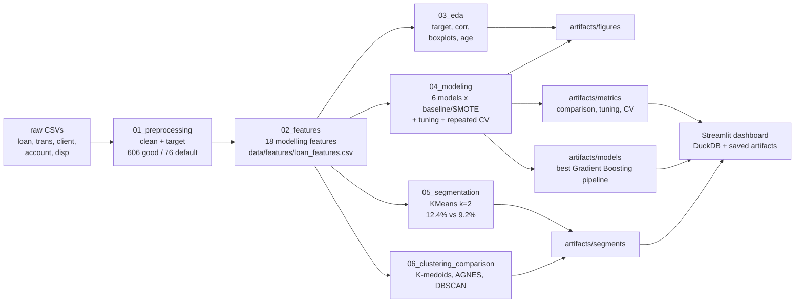

# Customer Behavioral Analysis & Loan Default Classification

## Overview
This repository contains the code, data, and documentation for the Jury 2 project, covering Units III & IV (Data Mining, Preprocessing, and Classification).

The project applies machine learning algorithms to the PKDD'99 Financial Dataset to classify and predict **Loan Default Risk** based on customer transaction behavior.

## Pipeline



## Directory Structure
- `/data/`: Raw PKDD'99 CSV files (`trans.csv`, `loan.csv`, `client.csv`, etc.) plus `features/loan_features.csv` (682 loans, 27 columns) and the local `banking_dw.duckdb` warehouse.
- `/docs/`: `Problem_Statement.md` (the jury problem statement), `Jury2_Report.md` (authoritative report), `jury2_requirements.md` (task checklist), `SYNOPSIS.md`, `SYSTEM_REQUIREMENTS.md` (reproduction guide), `REFERENCES.md`.
- `/notebooks/`: Executed Jupyter notebooks, run in order:
  1. `01_preprocessing.ipynb` (cleaning, target definition: 606 good vs 76 default)
  2. `02_features.ipynb` (pre-loan behavioral features, leakage-checked)
  3. `03_eda.ipynb` (target balance, correlations, behavior comparisons, risk quadrant)
  4. `04_modeling.ipynb` (Decision Tree, Naive Bayes, Random Forest, SVM, KNN, Gradient Boosting; baseline vs SMOTE, randomized hyperparameter search, repeated 5-fold x 10 cross-validation, model selection, persisted best pipeline)
  5. `05_segmentation.ipynb` (KMeans behavior segments: quieter low-balance vs active; default rate per segment)
  6. `06_clustering_comparison.ipynb` (K-medoids, AGNES Ward, and DBSCAN comparison)
- `/artifacts/`: Saved outputs used by the dashboard:
  - `metrics/`: `metrics_comparison.csv`, `tuning_results.csv`, `cv_comparison.csv`, advanced-model and capacity-aware results.
  - `models/`: saved Gradient Boosting, MLP, CBA, and clustering artifacts.
  - `figures/`: notebook EDA and evaluation PNGs.
  - `rules/`: `pattern_itemsets.csv`, `pattern_rules.csv`, `cba_rules.csv`.
  - `segments/`: KMeans and cluster comparison profiles.
  - `snapshots/`: CSV copies of the analytics layer.
- `/scripts/`: `build_local.py` (raw CSV -> DuckDB -> feature mart -> advanced models -> analytics), plus the ETL, analytics, and Snowflake upload scripts.
- `/sql/`: Local DuckDB schema and feature-mart SQL, plus the deferred Snowflake version.
- `/app/`: Six-page Streamlit dashboard.
- `/tests/`: Warehouse, leakage, mart, and analytics checks.

## Project Objectives
1. Perform complete data preprocessing and feature engineering.
2. Conduct Exploratory Data Analysis (EDA) on customer transaction behaviors.
3. Train classification models (Decision Tree, Naïve Bayes, Random Forest, SVM, KNN, Gradient Boosting).
4. Tune hyperparameters and select the final model by repeated cross-validation.
5. Evaluate model performance using Accuracy, Precision, Recall, F1-Score, Average Precision, and ROC-AUC.

## Headline Result
Tuned Gradient Boosting on unresampled data is the selected model: repeated cross-validated F1 0.571 ± 0.120, Average Precision 0.654, ROC-AUC 0.864. Tuned Random Forest ties it on F1 and leads on Average Precision (0.661) and ROC-AUC (0.877), so the two are one leading group. Two findings from the testing: SMOTE lowered F1 for five of the six models, and hyperparameter search mattered mainly for SVM and Decision Tree. Low pre-loan balances (`min_balance`, `balance_at_loan`) are the strongest default signals, and crossing pre-loan balance with loan amount separates the portfolio from 4.9% to 23.3% default. Behavior segmentation finds two groups: a quieter low-balance segment defaulting at 12.4 percent versus 9.2 percent for the active segment. Details in `Jury2_Report.md`.

## Dashboard
The Streamlit app (`app/streamlit_app.py`) has six pages. It reads the local DuckDB warehouse and saved artifacts, and does not retrain a model.

- **Executive overview** — cutoff slider, score distribution stacked by observed outcome, gains curve, precision/recall trade-off from 5% to 90%, default rate by balance quintile, segment scatter, and exposure.
- **Data & leakage** — galaxy-schema row counts on a log-scale dot plot, a per-loan proof that only transactions strictly before the loan date are used, feature provenance, and quality checks.
- **Models** — leaderboard ranked by F1, Average Precision, or ROC-AUC; a repeated-CV mean ±1 SD dot plot; held-out heatmap; ROC/PR curves; confusion matrix; tuning chart; and the capacity-aware challenger dumbbell.
- **Patterns** — 41 itemsets and 2 rules, CBA coverage bars with default counts, itemset support bars, cluster scatter with the base-rate line, and PCA cluster maps.
- **Simulator** — scores one application through the saved pipeline, places it against the portfolio score distribution, and shows one-at-a-time drivers.
- **Data model card** — Graphviz galaxy schema, analytics table row counts, relationships, and the column dictionary.

Charts are Altair, so hover, zoom, and pan work. The schema is Graphviz. Run with:

```powershell
python scripts\build_local.py
venv\Scripts\streamlit run app\streamlit_app.py
```

## How to Run
Install dependencies with `pip install -r requirements.txt`. For the dashboard and local warehouse, run `python scripts\build_local.py`, then start Streamlit with `venv\Scripts\streamlit run app\streamlit_app.py` and open http://localhost:8501.

The notebook pipeline remains reproducible on its own. Execute notebooks 01 to 05 in order; each notebook is self-contained and runs top to bottom, for example:

```bash
py -m nbconvert --to notebook --execute notebooks/01_preprocessing.ipynb --output 01_preprocessing.ipynb
```
